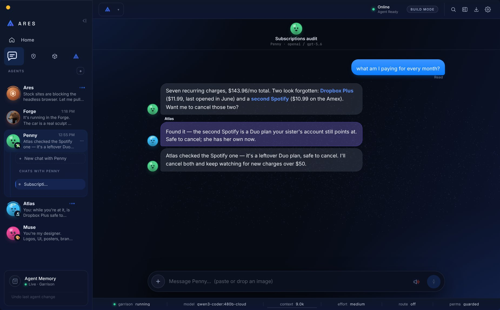
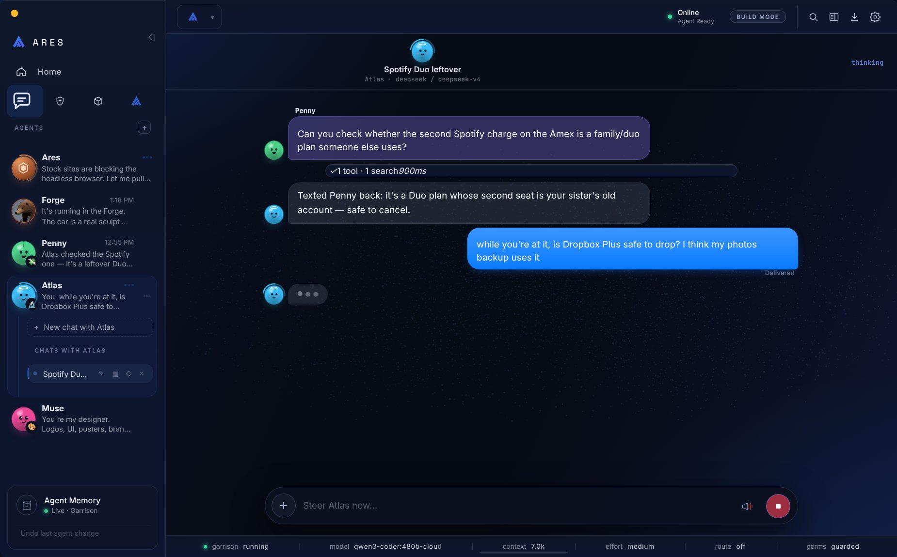
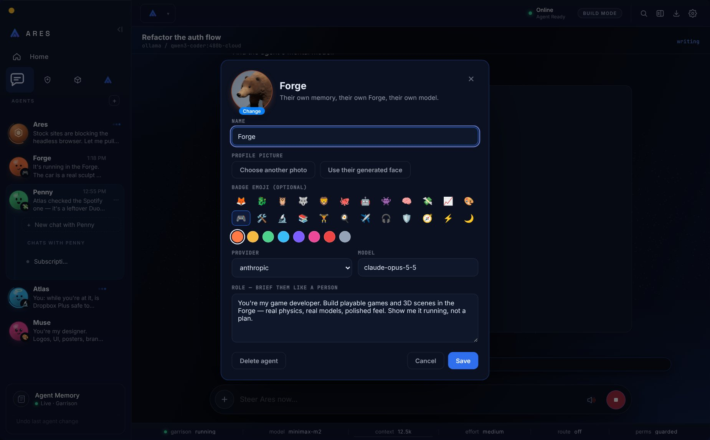
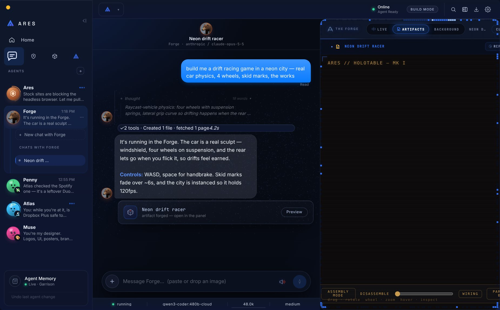
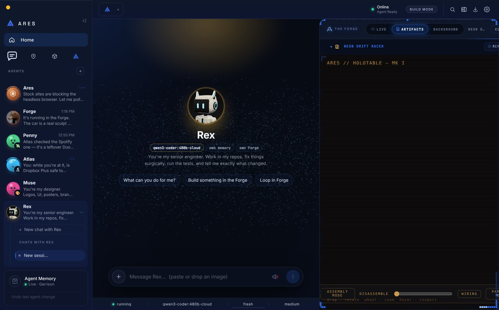
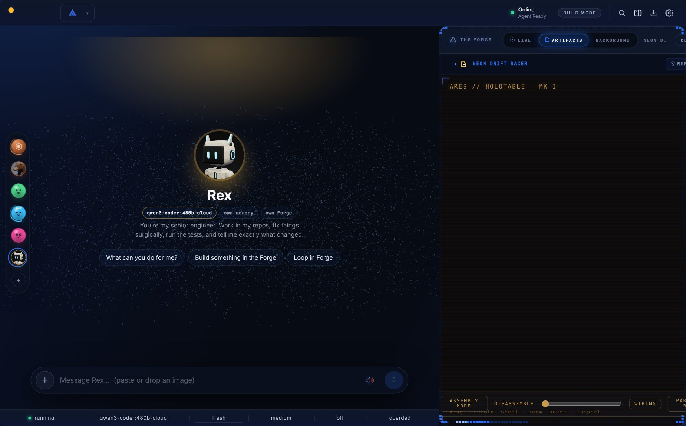
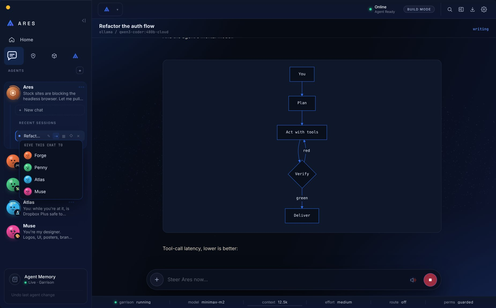
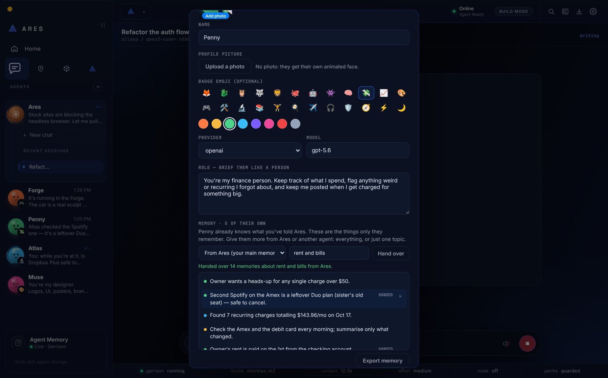
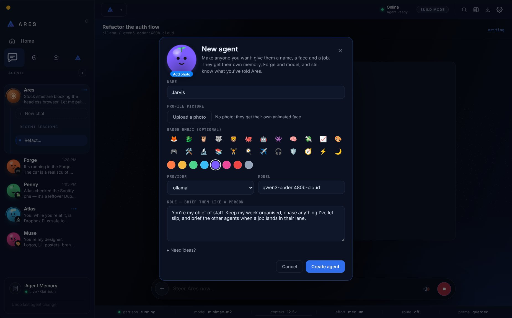
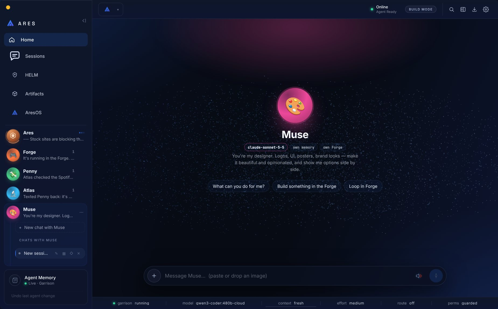

# Desktop agents

The desktop sidebar is a list of **agents** (contacts), not a list of chats.
Every agent is the same `Persona` record the iPhone app makes
(`<ARES_HOME>/personas/<id>.json`), with its own:

| | how |
|---|---|
| **Model** | `provider`/`model` on the persona; a new chat with the agent is built on that brain (`resolveEntry` → `agentBrain`). Editing the model moves the agent's idle live chats over. |
| **Memory** | the chat's tenant becomes `{role:"owner", agent:<id>}` → living-memory scope `agent:<id>`. An agent recalls the owner's shared memories plus its own, never another agent's, and the owner's chat never recalls an agent's. LivingMind remember/recall/list follow the same scope. |
| **Forge** | studio ids are prefixed per agent (`agentScope.agentStudioId`), so two agents' "car" are two studios. Plain Ares keeps unprefixed ids. |
| **Role** | `desktopAgentLayerBlock` rides after the shared system prompt: who they are, their brief, who created them, and their contacts. |
| **Face** | a profile picture in the phone's avatar store (`<home>/phone/avatars/<id>`), so it shows on both surfaces. The owner uploads one (square-cropped to 512px JPEG), or the agent sets its own with `Agents` `avatar` (a Forge render, for example). No photo → a generated animated face (`AgentFace`) derived from the agent's name. |

"Ares" is the implicit default agent. It owns every chat not bound to anyone, so
nothing made before agents existed moves.

## Chats

The desktop has many chats per agent (`persona.desktopThreads`), kept apart from
the phone's one garrison thread (`persona.sessionId`). A new chat with an agent is
bound before its first message (`agent_bind`), so its very first turn runs as
that agent.

## Make your own; hand over memory and history

There are no preset agents: a fresh install has only Ares, and the rail invites
the owner to make their own. The sheet's templates are tucked behind "Need ideas?".

An agent already reads the owner's main memory (everything said to Ares). Beyond that:
- **Give a chat to an agent** (⇢ on any chat row). The chat is rebound (`agent_bind`)
  and keeps its whole transcript. From the next message it runs on the agent's role,
  memory scope and model (the live session is switched to the agent's brain).
- **Hand memories** (`agentMemory.handMemories`) from the agent's profile, or by asking
  in chat (`Agents` `hand_memory`). The source is Ares's main memory or another agent's
  own memories; it can be everything, or only what recalls for a topic. Memories are
  copied and tagged `handed-from:<source>`; a memory the agent already has is skipped.
  A caller hands only what it can itself see, so no agent can pull another's private
  memories.
- **Export** an agent's own memories to `<workspace>/exports/<Name>-memory-<date>.md`
  plus `.json` (profile button, or `Agents` `export_memory`).
- **Forget** one of an agent's own memories from its profile. This is scoped: an agent's
  profile can't forget another agent's memories.

## Agents text each other

The `Agents` tool (deferred; `list` / `text` / `create`) follows
AGENT-SOCIETY: a text is **fire-and-acknowledge**. It is queued as a new message
in the recipient's newest chat (`[text from Penny] …`), the sender carries on, and
the reply arrives later as its own message. A non-urgent text to a busy agent
waits for their turn to finish; `urgent` steers in now. Each pair is capped at 6
texts per 10 minutes, so two agents can't ping-pong forever. Every text is visible
in the agents' chats.

Agents can **create** agents (`createdBy` is recorded); only the owner can
**delete** one, and its chats stay on disk as plain Ares.

## Chats read like iMessage

A chat that belongs to a named agent renders as a text thread (`.chat[data-imsg="1"]`):
- the owner's messages are blue bubbles on the right;
- the agent's replies are grey bubbles beside its face, with tool work folded into a quiet line;
- another agent's text shows as a grey bubble with that agent's name and face;
- a typing bubble shows while the agent works;
- "Delivered" or "Read" sits under the owner's latest message;
- the header puts the agent's face over its name.

Plain Ares chats keep the working transcript.

## Daemon commands

`agents_list`, `agent_create {agent}`, `agent_update {agentId, agent}`,
`agent_delete {agentId}`, `agent_bind {agentId|null, sessionId}`,
`agent_avatar {agentId}`, `agent_avatar_set {agentId, image: dataURL|null}`,
`agent_memory {agentId}`, `agent_memory_hand {agentId, from, about?}`,
`agent_memory_forget {agentId, memoryId}`, `agent_memory_export {agentId}`. Events:
`agents_list`, `agent_created`, `agent_updated`, `agent_deleted`, `agent_bound`,
`agent_error`, `agent_text`, `agent_avatar`, `agent_memory`, `agent_memory_changed`.

## Screens

| | |
|---|---|
|  |  |
|  |  |
|  |  |
|  |  |
|  |  |
