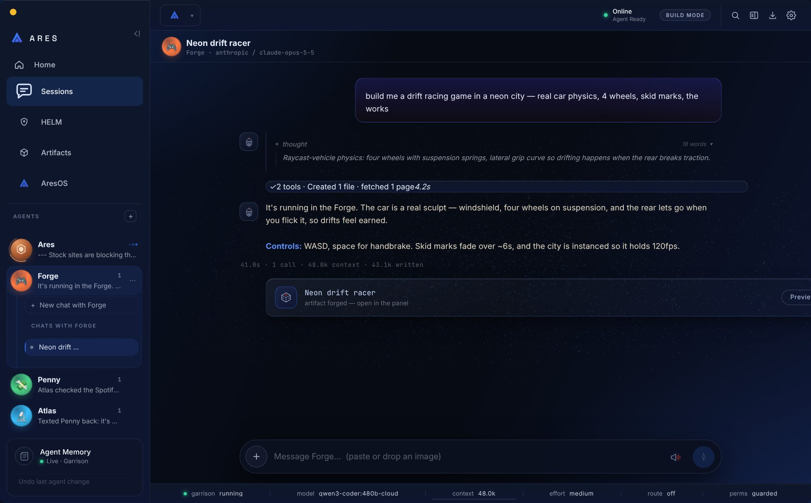
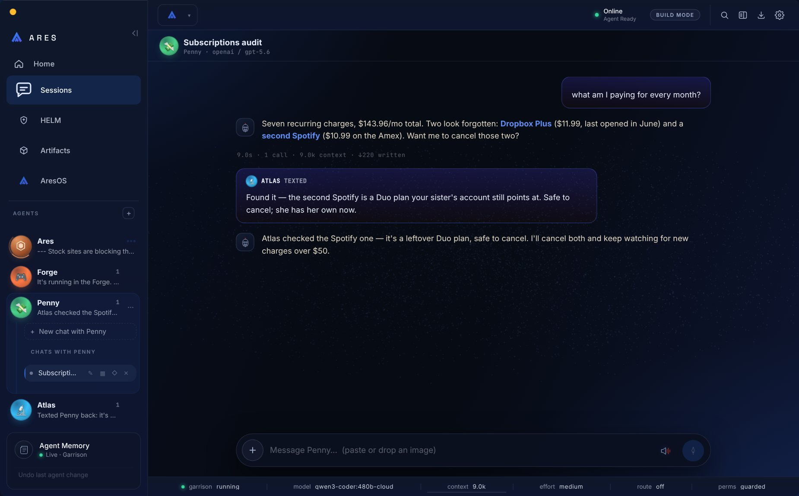
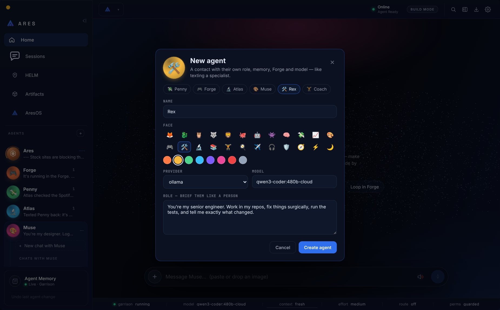
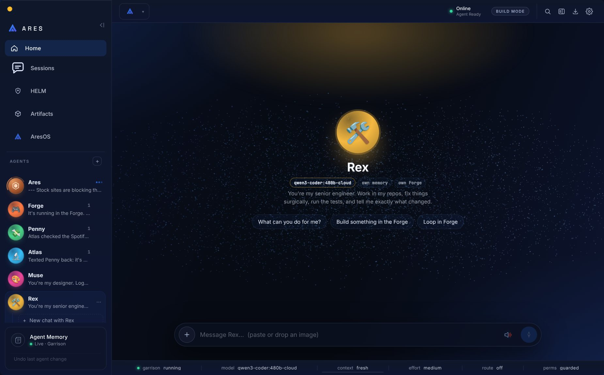
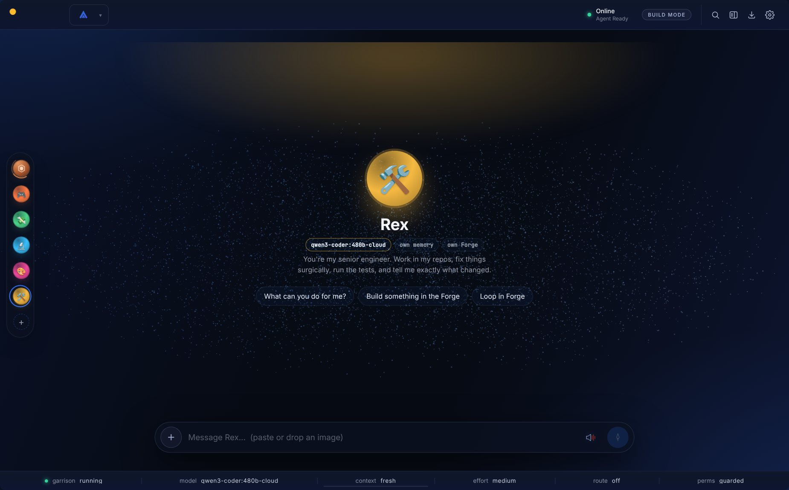

# Desktop agents

The desktop sidebar is a list of **agents** (contacts), not a list of chats.
Every agent is the same `Persona` record the iPhone app makes
(`<ARES_HOME>/personas/<id>.json`), with its own:

| | how |
|---|---|
| **Model** | `provider`/`model` on the persona; a new chat with the agent is built on that brain (`resolveEntry` → `agentBrain`). Editing the model moves the agent's idle live chats over. |
| **Memory** | the chat's tenant becomes `{role:"owner", agent:<id>}` → living-memory scope `agent:<id>`. An agent recalls the owner's shared memories plus its own, never another agent's, and the owner's chat never recalls an agent's. LivingMind remember/recall/list follow the same scope. |
| **Forge** | studio ids are prefixed per agent (`agentScope.agentStudioId`), so two agents' "car" are two studios. Plain Ares keeps unprefixed ids. |
| **Role** | `desktopAgentLayerBlock` rides after the shared system prompt: who they are, their brief, who created them, and their contacts. |

"Ares" is the implicit default agent. It owns every chat not bound to anyone, so
nothing made before agents existed moves.

## Chats

The desktop has many chats per agent (`persona.desktopThreads`), kept apart from
the phone's one garrison thread (`persona.sessionId`). A new chat with an agent is
bound before its first message (`agent_bind`), so its very first turn runs as
that agent.

## Agents text each other

The `Agents` tool (deferred; `list` / `text` / `create`) follows
AGENT-SOCIETY: a text is **fire-and-acknowledge**. It is queued as a new message
in the recipient's newest chat (`[text from Penny] …`), the sender carries on, and
the reply arrives later as its own message. A non-urgent text to a busy agent
waits for their turn to finish; `urgent` steers in now. Each pair is capped at 6
texts per 10 minutes, so two agents can't ping-pong forever. Every text is visible
in the agents' chats.

Agents can **create** agents (`createdBy` is recorded); only the owner can
**delete** one, and its chats stay on disk as plain Ares.

## Daemon commands

`agents_list`, `agent_create {agent}`, `agent_update {agentId, agent}`,
`agent_delete {agentId}`, `agent_bind {agentId|null, sessionId}`. Events:
`agents_list`, `agent_created`, `agent_updated`, `agent_deleted`, `agent_bound`,
`agent_error`, `agent_text`.

## Screens

| | |
|---|---|
|  |  |
|  |  |
|  |  |
